# Online-Ausgangszustand

- Testdatum: 25.11.2026
- Netzwerkstatus: Online (No throttling)
- Aufgerufene Seite: `/sessions`
- Angezeigter Datenstand: 25.11.2026, 13:38
- Anzahl der angezeigten Sessions: 20

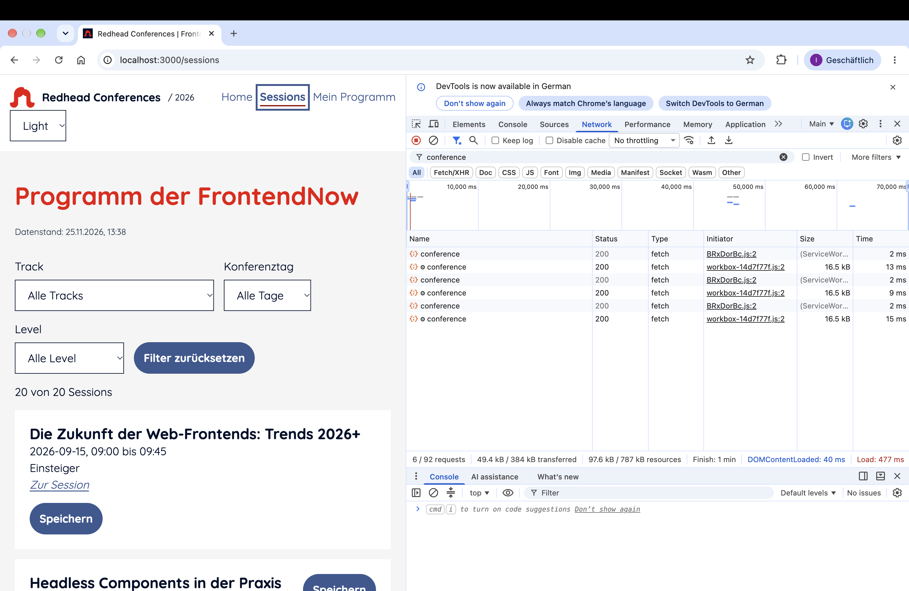

# Verifikationsnachweis – Schritt 3: PWA & Offline-Strategie

## 1. Allgemeine Informationen

- Projekt: Redhead Conferences – FrontendNow
- Testdatum: 25.11.2026
- Testperson: Knotek
- Betriebssystem: macOS
- Browser: Google Chrome
- Testumgebung: http://localhost:3000
- Testwerkzeug: Chrome DevTools
- Testmethode: Manuelle Online- und Offline-Tests
- Status: For Review

## 2. Service Worker und Cache Storage

### 2.1 Registrierung des Service Workers

Der Service Worker wurde in Chrome DevTools unter
Application > Service workers überprüft.

Er ist registriert, aktiviert und wird ausgeführt.

Erwartetes Ergebnis: Der Service Worker ist aktiv.

Tatsächliches Ergebnis: Der Service Worker wird mit dem
Status "activated and is running" angezeigt.

**Ergebnis: Bestanden**

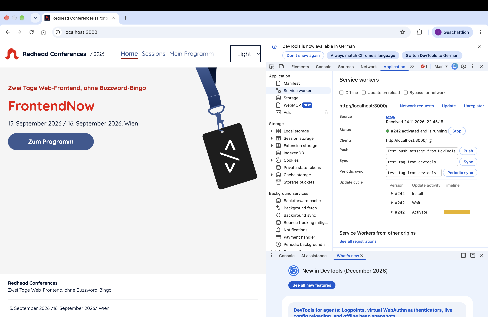

### 2.2 Speicherung der Konferenzdaten

Unter Application > Cache storage wurde der Runtime-Cache
`redhead-conference-data` überprüft.

Der Cache enthält die Antwort des API-Endpunkts
`/api/conference` im JSON-Format. Die gespeicherte Antwort
enthält die Konferenzdaten sowie einen Zeitstempel
unter `updatedAt`.

Erwartetes Ergebnis: Die Konferenzdaten werden im
Runtime-Cache gespeichert.

Tatsächliches Ergebnis: Der API-Endpunkt ist im Cache
vorhanden und die gespeicherte Antwort kann eingesehen werden.

**Ergebnis: Bestanden**

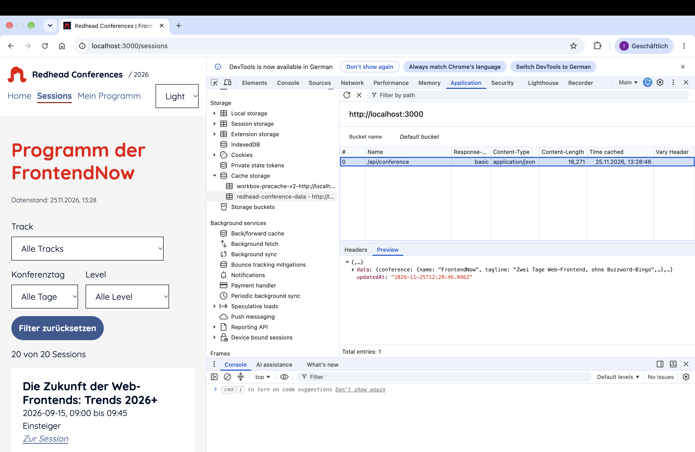

## 3. Szenario 1: Konferenzprogramm offline nutzen

### 3.1 Session-Übersicht im Online-Modus

Die Session-Übersicht wurde zunächst mit bestehender
Internetverbindung geöffnet.

Alle 20 Sessions werden angezeigt. Zusätzlich ist der
Datenstand der Konferenzinformationen sichtbar.

### 3.2 Session-Übersicht im Offline-Modus

In Chrome DevTools wurde unter Network die
Netzwerkeinstellung auf Offline gesetzt.

Erwartetes Ergebnis: Die zuvor geladenen Konferenzdaten
bleiben ohne Internetverbindung verfügbar.

Tatsächliches Ergebnis: Alle 20 Sessions werden weiterhin
angezeigt.

**Ergebnis: Bestanden**

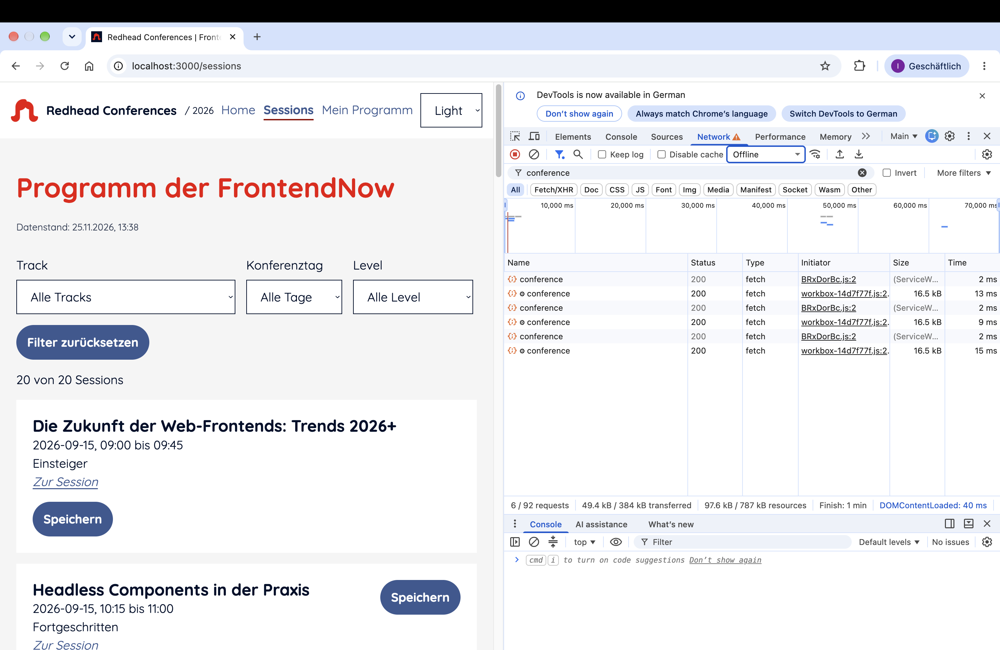

### 3.3 Filterfunktion im Offline-Modus

Im Offline-Modus wurden folgende Filter ausgewählt:

- Track: Keynotes & Podium
- Konferenztag: 2026-09-15
- Level: Einsteiger

Erwartetes Ergebnis: Die Session-Liste wird anhand der
ausgewählten Filter lokal aktualisiert.

Tatsächliches Ergebnis: Eine von insgesamt 20 Sessions
entspricht den gewählten Filterkriterien und wird angezeigt.

**Ergebnis: Bestanden**

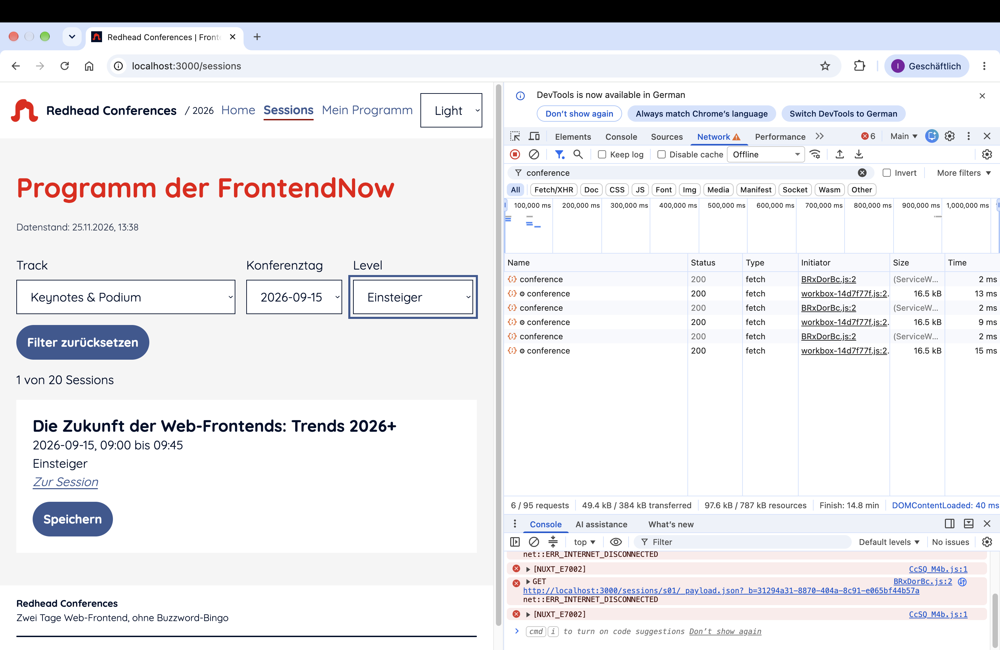

### 3.4 Session-Detailseite im Offline-Modus

Die Detailseite der Session mit der ID `s01` wurde
über die interne Navigation geöffnet.

Erwartetes Ergebnis: Die Session-Informationen sind
ohne Internetverbindung verfügbar.

Tatsächliches Ergebnis: Titel, Beschreibung, Datum,
Uhrzeit, Raum und Speaker-Informationen werden angezeigt.

**Ergebnis: Bestanden**

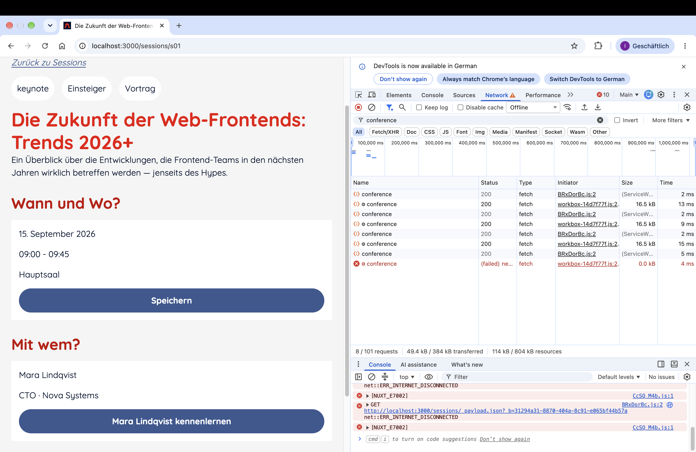

### 3.5 Speaker-Detailseite im Offline-Modus

Die Speaker-Detailseite mit der ID `sp01` wurde
über die interne Navigation geöffnet.

Erwartetes Ergebnis: Die Speaker-Informationen und
zugehörigen Sessions sind offline verfügbar.

Tatsächliches Ergebnis: Name, berufliche Position,
Beschreibung und zugehörige Sessions werden angezeigt.

**Ergebnis: Bestanden**

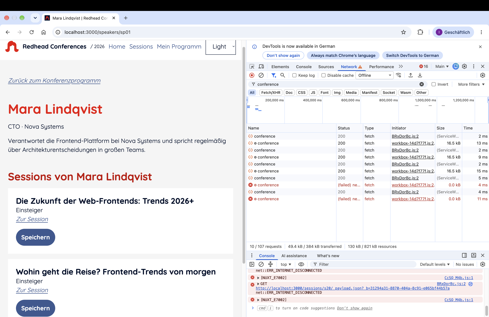

### 3.6 Überprüfung der Netzwerkanfragen

Im Network-Tab wurden die Anfragen an `/api/conference`
untersucht.

Bei deaktivierter Internetverbindung ist eine erfolgreiche
Antwort mit Status 200 über den Service Worker sichtbar.
Die parallele Netzwerkanfrage von Workbox schlägt fehl.

Es werden 0,0 kB über das Netzwerk übertragen.

Dieses Verhalten entspricht der eingesetzten
Stale-While-Revalidate-Strategie.

**Ergebnis: Bestanden**

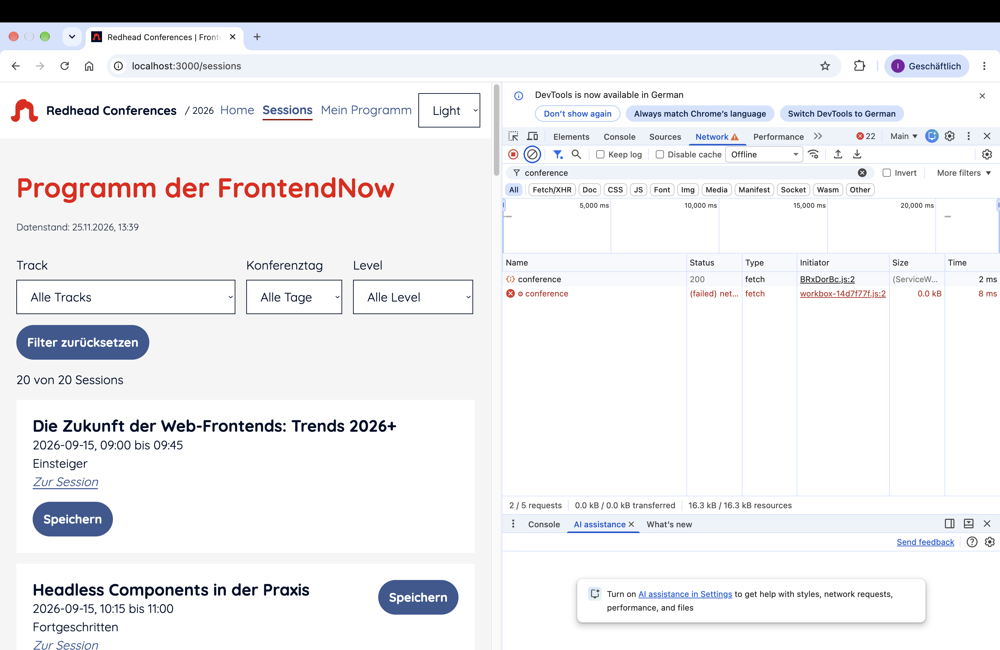

## 4. Szenario 2: Persönliches Programm offline nutzen

### 4.1 Persönliches Programm im Online-Modus

Zunächst wurden mehrere Sessions gespeichert und
die Seite Mein Programm geöffnet.

Die ausgewählten Sessions werden nach Konferenztagen
gruppiert dargestellt.

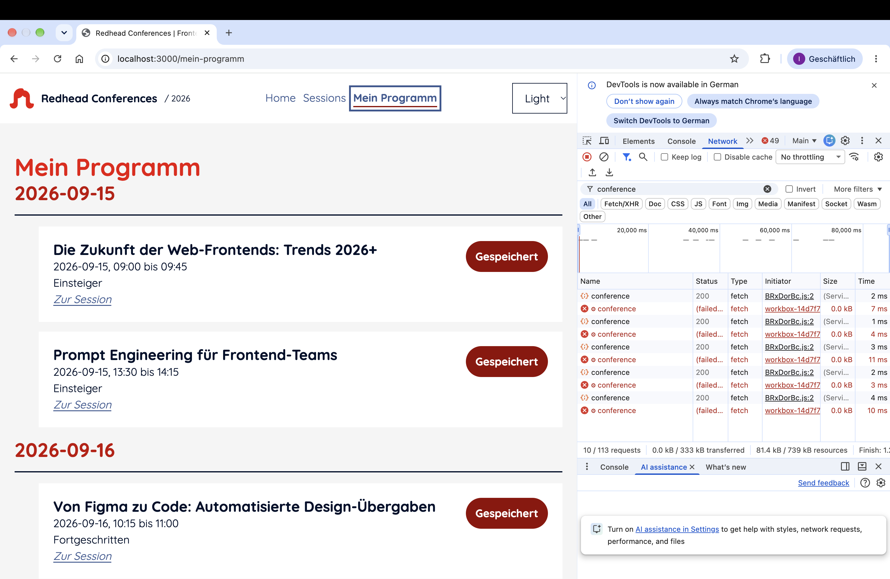

### 4.2 Überprüfung des LocalStorage

Unter Application > Local storage wurde die lokale
Speicherung der ausgewählten Sessions überprüft.

Der Schlüssel `myProgram` enthält die gespeicherten
Session-IDs:

`["s13","s08","s01"]`

Erwartetes Ergebnis: Die persönliche Auswahl wird
unabhängig von einer Serververbindung lokal gespeichert.

Tatsächliches Ergebnis: Die Session-IDs sind im
LocalStorage vorhanden.

**Ergebnis: Bestanden**

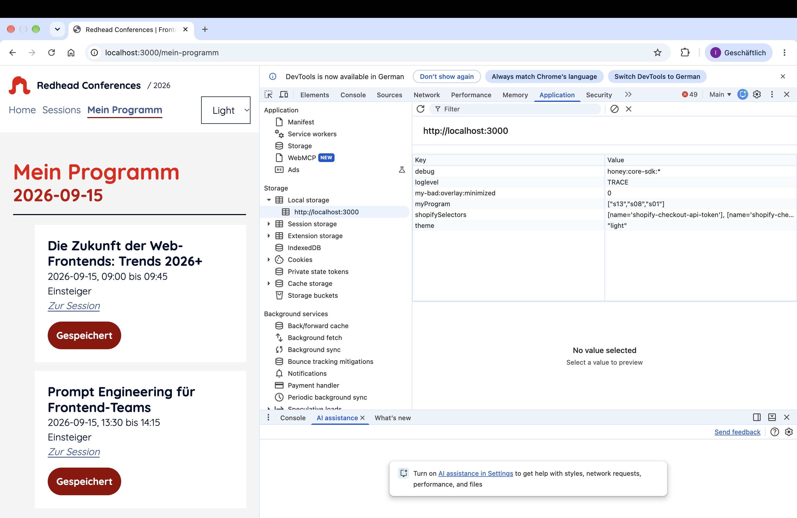

### 4.3 Persönliches Programm im Offline-Modus

Die Internetverbindung wurde über Chrome DevTools
deaktiviert und das persönliche Programm aufgerufen.

Erwartetes Ergebnis: Die zuvor gespeicherten Sessions
bleiben verfügbar.

Tatsächliches Ergebnis: Alle drei zuvor ausgewählten
Sessions werden weiterhin angezeigt.

**Ergebnis: Bestanden**

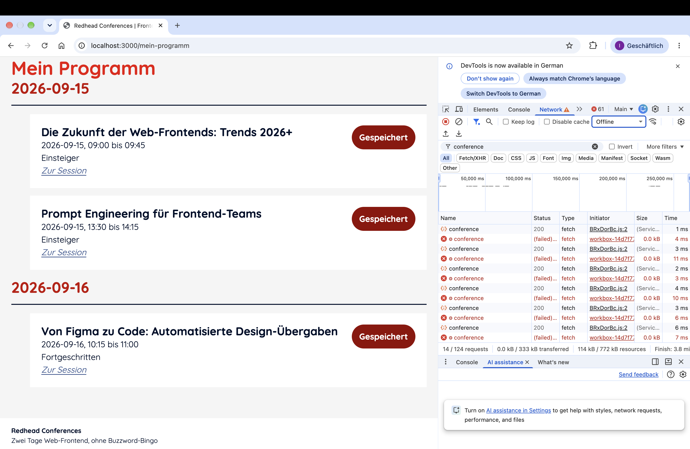

### 4.4 Bearbeitung des persönlichen Programms

Im Offline-Modus wurde die persönliche Session-Auswahl
verändert.

Die Session "Von Figma zu Code: Automatisierte
Design-Übergaben" wurde aus der Auswahl entfernt.

Die Session "CSR vs. SSR vs. SSG: Die richtige
Strategie wählen" wurde hinzugefügt.

Erwartetes Ergebnis: Sessions können ohne aktive
Internetverbindung hinzugefügt und entfernt werden.

Tatsächliches Ergebnis: Das persönliche Programm
zeigt die geänderte Auswahl an.

**Ergebnis: Bestanden**

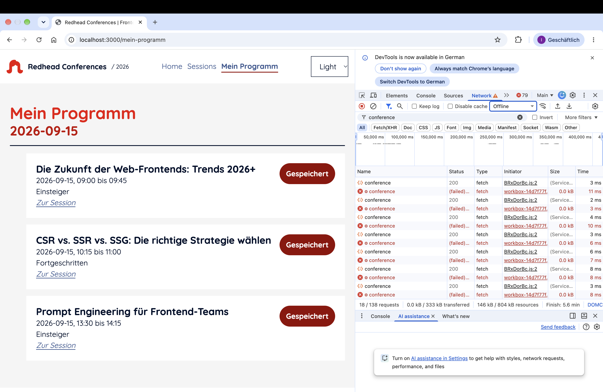

### 4.5 Persönliches Programm nach Offline-Reload

Die Anwendung wurde bei deaktivierter Internetverbindung
erneut geladen.

Erwartetes Ergebnis: Die Anwendung bleibt verfügbar
und die persönliche Auswahl bleibt gespeichert.

Tatsächliches Ergebnis: Die Anwendung wird geladen,
zeigt jedoch zunächst die Startseite an.

Laut manueller Testbeobachtung bleibt das persönliche
Programm nach erneuter Navigation verfügbar.

Die direkte Wiederherstellung der ursprünglich
aufgerufenen Route funktioniert nicht zuverlässig.

Der Screenshot dokumentiert die verfügbare Startseite,
jedoch nicht unmittelbar die gespeicherte Auswahl
nach dem Reload.

**Ergebnis: Teilweise bestanden**

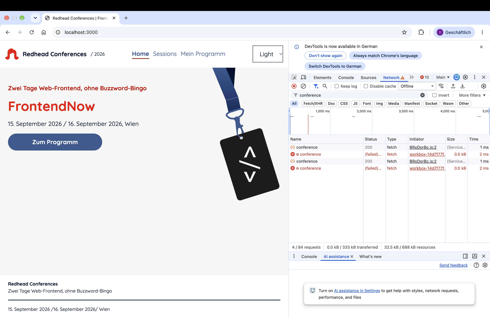

## 5. Szenario 3: Erstmaliger Aufruf ohne Internetverbindung

Für die Simulation eines erstmaligen Aufrufs wurde
ein Inkognito-Fenster verwendet.

Die Netzwerkeinstellung wurde auf Offline gesetzt
und die Anwendung aufgerufen.

Erwartetes Ergebnis: Ohne vorherigen Online-Aufruf
und ohne vorhandenen Cache kann die Anwendung
nicht geladen werden.

Tatsächliches Ergebnis: Chrome zeigt die
standardmäßige Offline-Fehlerseite mit dem Fehlercode
`ERR_INTERNET_DISCONNECTED` an.

Dies entspricht dem erwarteten Verhalten eines
Offline-Erstbesuchs ohne gespeicherte Ressourcen.

**Ergebnis: Bestanden, sofern kein vorheriger Online-Aufruf
innerhalb derselben Inkognito-Sitzung stattgefunden hat.**

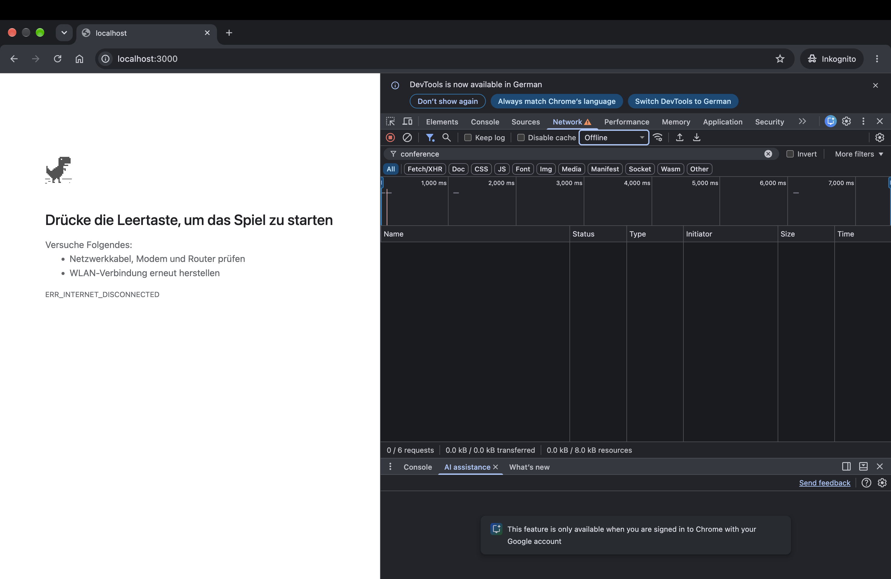

## 6. Aktualisierung nach Wiederherstellung der Verbindung

Die Netzwerkeinstellung wurde von Offline auf
No throttling zurückgesetzt.

Erwartetes Ergebnis: Bei erneutem erfolgreichem
Netzwerkabruf werden die gespeicherten Konferenzdaten
aktualisiert.

Tatsächliches Ergebnis: Laut manueller Testbeobachtung
wurde der Datenstand nach Wiederherstellung der
Verbindung aktualisiert.

Der Screenshot dokumentiert die wiederhergestellte
Netzwerkeinstellung und die weiterhin verfügbare
Session-Übersicht.

Die sichtbaren Netzwerkeinträge enthalten allerdings
noch fehlgeschlagene Anfragen aus dem vorherigen
Offline-Test. Eine erfolgreiche neue Netzwerkantwort
ist in diesem Screenshot nicht eindeutig nachgewiesen.

**Ergebnis: Laut manueller Beobachtung bestanden;
ergänzender Screenshot empfohlen.**

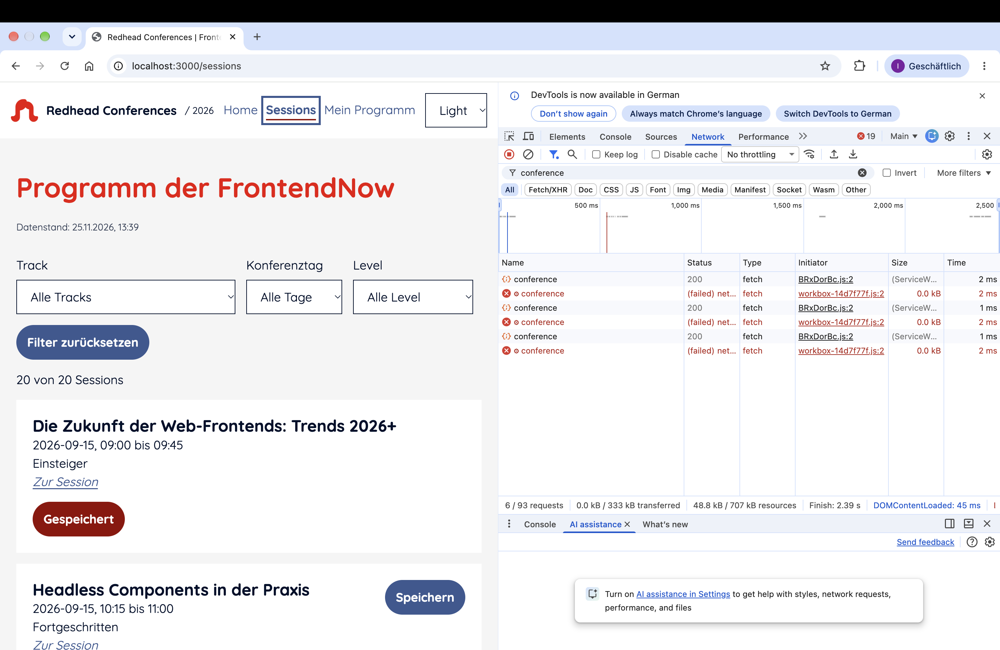

## 7. Zusätzlicher Test: Session-Übersicht nach Offline-Reload

Die Anwendung wurde bei deaktivierter Internetverbindung
erneut geladen.

Dabei wurde zunächst die Startseite angezeigt.

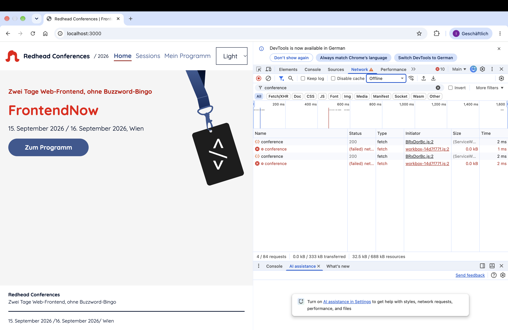

Anschließend wurde über die interne Navigation erneut
die Session-Übersicht geöffnet.

Alle 20 Sessions und der gespeicherte Datenstand
wurden weiterhin angezeigt.

Die Konferenzdaten bleiben somit verfügbar.
Die ursprünglich aufgerufene Route wird jedoch nicht
unmittelbar wiederhergestellt.

**Ergebnis: Teilweise bestanden**

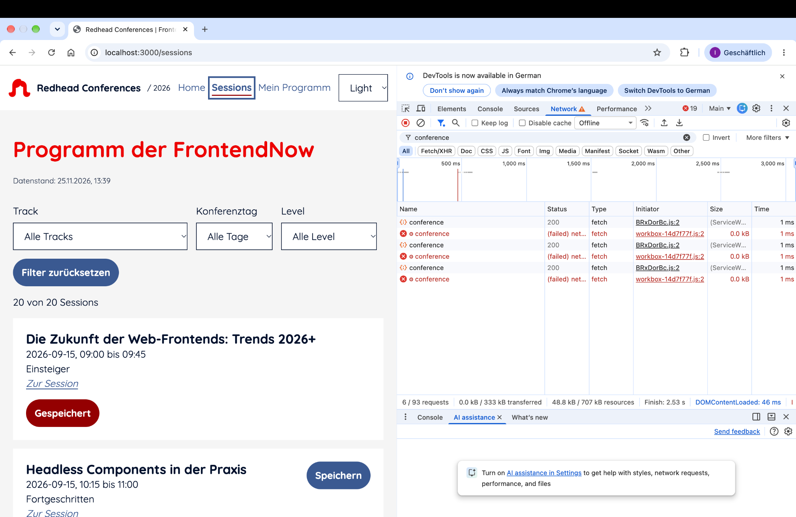

## 8. Zusammenfassung der Testergebnisse

| Testfall | Ergebnis | Screenshot |
| --- | --- | --- |
| Service Worker aktiv | Bestanden | 01 |
| Konferenzdaten im Runtime-Cache | Bestanden | 02 |
| Session-Übersicht online | Bestanden | 03 |
| Session-Übersicht offline | Bestanden | 04 |
| Session-Filter offline | Bestanden | 05 |
| Session-Detailseite offline | Bestanden | 06 |
| Speaker-Detailseite offline | Bestanden | 07 |
| Cache-Antwort bei Netzwerkausfall | Bestanden | 08 |
| Persönliches Programm online | Bestanden | 09 |
| Speicherung im LocalStorage | Bestanden | 10 |
| Persönliches Programm offline | Bestanden | 11 |
| Persönliches Programm offline bearbeitbar | Bestanden | 12 |
| Persönliches Programm nach Offline-Reload | Teilweise bestanden | 13 |
| Erstbesuch offline | Bestanden unter genannter Voraussetzung | 14 |
| Datenaktualisierung nach Wiederverbindung | Manuell bestätigt | 15 |
| Session-Übersicht nach Offline-Reload | Teilweise bestanden | 16, 17 |

## 9. Interpretation der Testergebnisse

Die durchgeführten Tests zeigen, dass die gewählte
Offline-Strategie die zentralen Anforderungen der
Konferenzplattform erfüllt. Der Service Worker ist aktiv
und speichert die Konferenzdaten im vorgesehenen
Runtime-Cache. Auch ohne Internetverbindung bleiben die
Session-Übersicht, die Filterfunktionen sowie die getesteten
Session- und Speaker-Detailseiten nutzbar.

Die Netzwerkanalyse bestätigt das erwartete Verhalten von
Stale-While-Revalidate: Gespeicherte Daten werden erfolgreich
bereitgestellt, während parallele Netzwerkzugriffe im
Offline-Modus fehlschlagen. Dadurch können Besucher:innen
weiterhin auf wichtige Konferenzinformationen zugreifen.

Die Speicherung der persönlichen Session-Auswahl im
LocalStorage ermöglicht außerdem eine Bearbeitung des
individuellen Programms ohne Serververbindung.

Eine Einschränkung besteht beim Offline-Reload, da zunächst
die Startseite erscheinen kann und eine erneute Navigation
notwendig ist. Zusätzlich treten fehlgeschlagene
Nuxt-Payload-Anfragen in der Browserkonsole auf, ohne die
getesteten Kernfunktionen vollständig zu blockieren.

Der simulierte Offline-Erstbesuch zeigt erwartungsgemäß
eine Browser-Fehlerseite, da keine zuvor gespeicherten
Ressourcen zur Verfügung stehen.

Die Aktualisierung nach Wiederherstellung der Verbindung
wurde bei der manuellen Prüfung beobachtet, sollte jedoch
durch einen eindeutigeren Netzwerk- und Cache-Nachweis
ergänzt werden.

Insgesamt bietet die Anwendung eine funktionale
Offline-Unterstützung für typische Konferenzsituationen.
Verbesserungspotenzial besteht insbesondere bei der
Wiederherstellung der ursprünglichen Route und der
Behandlung fehlgeschlagener Hintergrundanfragen.

## 10. Unabhängige Verifikation und Cross-Review

| Prüfung | Teammitglied 1 | Teammitglied 2 |
| --- | --- | --- |
| Konferenzprogramm offline | Offen | Durchgeführt |
| Persönliches Programm offline | Offen | Durchgeführt |
| Erstbesuch offline | Offen | Durchgeführt |
| Überprüfung der Caching-Strategie | Offen | Durchgeführt |
| Gegenseitiges Review | Offen | Offen |

Die Ergebnisse des zweiten unabhängigen Testdurchlaufs
werden nach Durchführung durch das andere Teammitglied
ergänzt.

## 11. Ergänzende PWA-Nachweise

Die Überprüfung des Web App Manifests sowie ein ergänzender
Lighthouse-Bericht sind mit dem PWA-Setup des anderen
Teammitglieds abzugleichen.

Die entsprechenden Nachweise werden nach der gemeinsamen
Überprüfung ergänzt.
